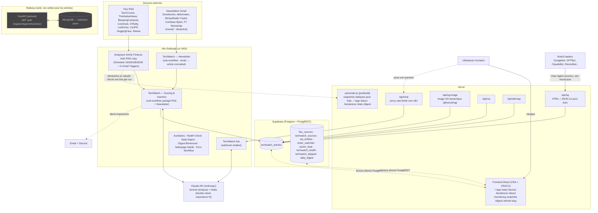
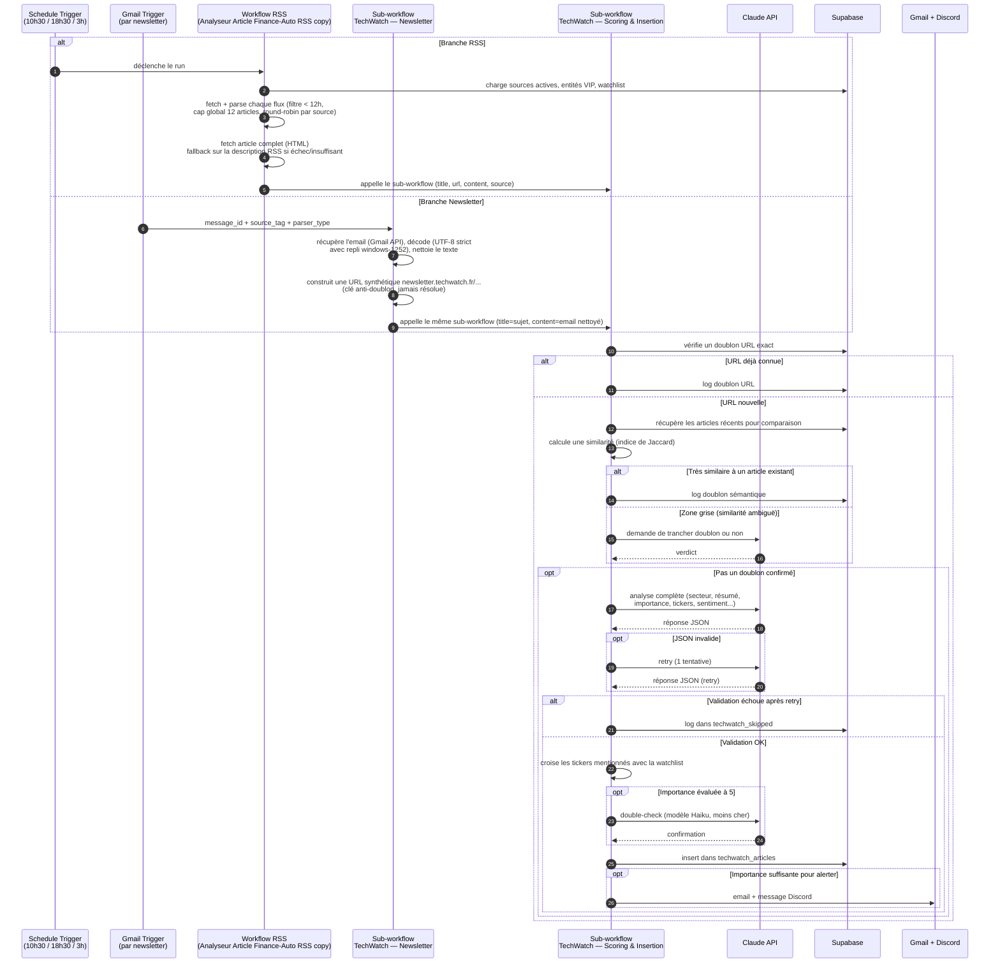
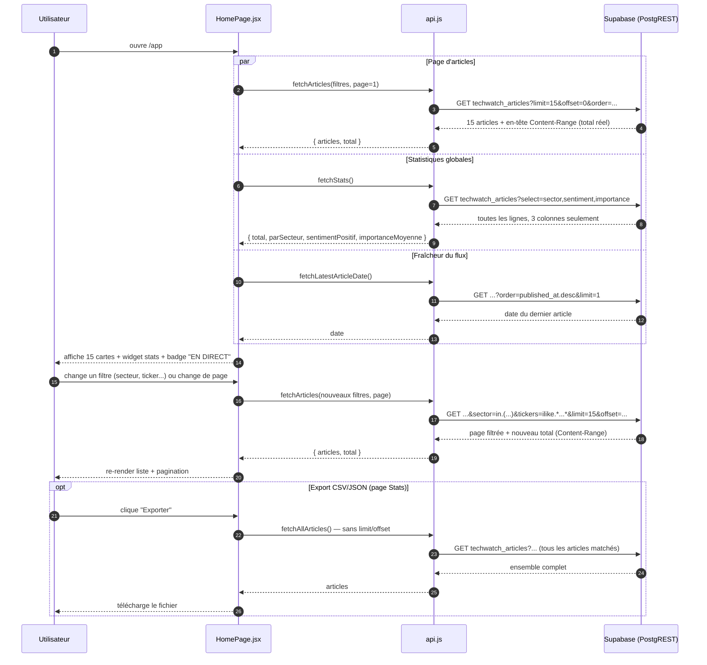
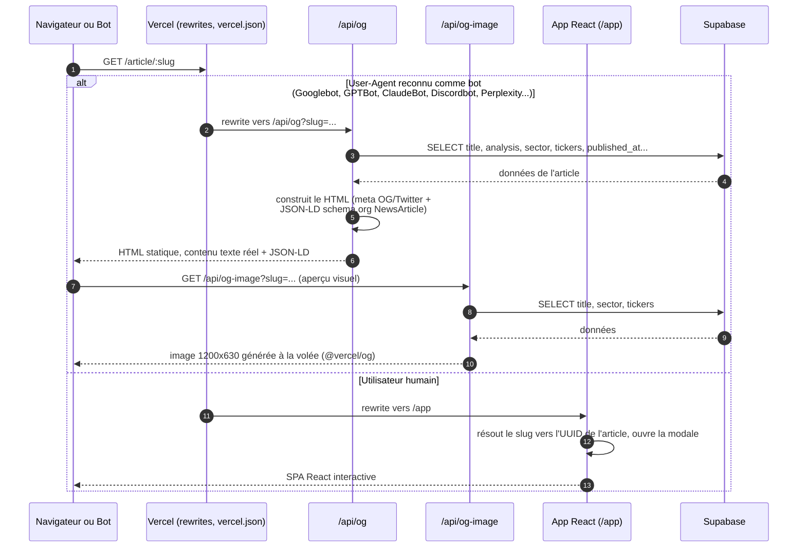

# Architecture — Tech Watch Dashboard

> Document généré à partir du code réel du dépôt (`frontend/`, `backend/`, `vercel.json`) et de l'inspection directe des workflows n8n en production (via l'API n8n, pas depuis les exports JSON du dossier `n8n-workflow/` qui peuvent être désynchronisés) et des tables Supabase (introspection via l'API REST avec la clé anon).
>
> Plusieurs points divergent de ce que décrit `CLAUDE.md` — c'est signalé explicitement à chaque fois plutôt que silencieusement corrigé, pour que vous sachiez quelle source fait foi.

## Sommaire
1. [Architecture globale](#1-architecture-globale)
2. [Parcours 1 — Pipeline d'ingestion (RSS + Newsletter → Scoring & Insertion)](#2-parcours-1--pipeline-dingestion)
3. [Parcours 2 — Navigation du dashboard (pagination/filtres serveur)](#3-parcours-2--navigation-du-dashboard)
4. [Parcours 3 — Rendu d'une page article : bot vs humain](#4-parcours-3--rendu-dune-page-article--bot-vs-humain)
5. [Modèle de données Supabase](#5-modèle-de-données-supabase)
6. [Incertitudes et points à vérifier](#6-incertitudes-et-points-à-vérifier)

---

## 1. Architecture globale

**Notes sur ce diagramme :**
- Le backend FastAPI/MongoDB (Railway) est grisé car **non branché au reste du système** : `/api/articles` et `/api/webhook/articles` existent dans le code (`backend/server.py:468` et `:488`) mais sont des stubs (`# TODO: Implémenter...`) qui ne lisent/écrivent jamais vraiment d'articles. Seuls `/auth/register`, `/auth/login`, `/auth/refresh`, `/auth/me` sont fonctionnels, et le frontend ne les appelle nulle part actuellement — cohérent avec `CLAUDE.md` ("L'auth n'est pas activement utilisée").
- `flux_sources` (colonnes `name, domain, type, active`) et `techwatch_sources` (colonnes `url_ou_label, source_tag, cap_par_run, type, actif`) sont **deux tables distinctes** malgré des noms proches : la première sert uniquement à l'affichage des badges source côté frontend, la seconde est la config interne que n8n lit pour savoir quels flux RSS poller. Elles ne sont pas synchronisées automatiquement l'une avec l'autre (vu dans le code : aucune jointure ni trigger entre les deux).

---

## 2. Parcours 1 — Pipeline d'ingestion

**Pourquoi celui-ci :** c'est le cœur fonctionnel du produit — rien d'autre n'existe sans lui. C'est aussi le parcours le plus complexe et le moins documenté avec précision ailleurs : `CLAUDE.md` décrit encore un flux newsletter avec un prompt Claude multi-articles et un parseur `---ARTICLE---/---FIN---`, **qui n'existe plus**. En inspectant le workflow réel (`TechWatch — Newsletter`, id `ViFCH4X61pPhdA0h`), chaque email devient un item unique (titre = sujet de l'email, contenu = corps nettoyé) qui passe par **le même sous-workflow partagé** que les articles RSS (`TechWatch — Scoring & Insertion`, id `NFtixJ68SY1xknQ5`). Ce document reflète donc l'état réel du workflow en production à la date de rédaction, pas `CLAUDE.md`.

---

## 3. Parcours 2 — Navigation du dashboard

**Pourquoi celui-ci :** c'est le parcours humain principal (le produit existe pour être consulté), et c'est la partie du code qu'on vient de reconstruire dans cette session (passage d'un chargement client-side intégral à une pagination serveur réelle) — donc documentée ici avec certitude totale, code en main, pas par inférence.

---

## 4. Parcours 3 — Rendu d'une page article : bot vs humain

**Pourquoi celui-ci :** ce n'est pas le comportement par défaut d'une SPA React — c'est une décision d'architecture distincte et peu évidente (deux chemins de rendu complets pour la même URL, routés par une regex User-Agent côté Vercel) qu'on a directement travaillée cette session (ajout du JSON-LD, correction d'une fuite d'URL localhost dans le prérendu). Utile à montrer parce que ça illustre un vrai compromis SEO/bot vs SPA plutôt qu'un pattern générique.

**Note connexe :** les pages publiques sans slug (`/`, `/app`, `/about`, `/tendances`, `/stats`, `/digest`) ont un troisième mécanisme — `prerender.js`, exécuté en `postbuild` après chaque déploiement Vercel, qui génère un snapshot HTML statique de chacune via Puppeteer pour que les mêmes bots voient du contenu réel sans exécuter React. Ce n'est pas schématisé ci-dessus pour ne pas surcharger le diagramme (parcours propre au build, pas à une requête utilisateur), mais ça fait partie de la même logique "contenu réel pour les bots".

---

## 5. Modèle de données Supabase

```mermaid
erDiagram
    techwatch_articles {
        uuid article_id PK
        text slug "probablement unique (route /article/:slug), contrainte non vérifiable via l'API REST"
        text title
        text title_en
        text original_title
        timestamptz published_at
        text url UK "clé anti-doublon côté n8n"
        text analysis "blob JSON stringifié (résumé, impact_marches, opportunites, points_cles...)"
        text impact_marches
        text opportunites
        text points_cles "array"
        int importance "0-5"
        text sentiment "Positif/Négatif/Neutre"
        text tickers "liste texte séparée par virgules, pas un array SQL"
        text sector
        text category "ex: finance-tech, cybersecurite — distinct de sector"
        bool in_scope "pipeline de scoring ; non filtré côté frontend actuellement"
        int tokens
        text source "ex: techcrunch, newsletter_aktionnaire"
        int source_count
        text score_reason
        timestamptz created_at
    }

    flux_sources {
        int id PK
        text name
        text domain
        text type "rss | newsletter"
        bool active
    }

    techwatch_sources {
        text url_ou_label "config d'ingestion n8n, lecture anon bloquée par RLS : schéma partiel"
        text source_tag
        int cap_par_run
        text type
        bool actif
    }

    vip_entities {
        int id PK
        text name
        bool active
    }

    ticker_watchlist {
        int id PK
        text ticker
        text label
        bool active
        timestamptz created_at
    }

    sector_heat {
        text sector "clé probable, non confirmée PK"
        int article_count
        float avg_importance
        int positive_count
        int negative_count
        int neutral_count
        float heat_score
        timestamptz last_article_at
    }

    techwatch_health {
        int id PK
        timestamptz checked_at
        int articles_24h
        int skipped_24h
        json flux_status "ex: {TechCrunch: ok, CoinDesk: ok, ...}"
    }

    techwatch_skipped {
        int id PK
        timestamptz skipped_at
        text url
        text original_title
        text reason
        text raw_output
    }

    daily_digest {
        int id PK
        date date
        text summary
        text top_articles "array"
        text sectors "array"
        int article_count
        timestamptz created_at
    }
```

**Aucune clé étrangère déclarée n'est visible depuis l'API REST** (PostgREST n'expose pas les contraintes, et l'accès `information_schema` n'a pas été testé/n'est probablement pas ouvert à la clé `anon`). Les tables ne sont donc **pas reliées par FK** dans ce diagramme — les liens réels sont par valeur :
- `techwatch_articles.source` est un texte libre (`techcrunch`, `newsletter_aktionnaire`...) qui correspond à `techwatch_sources.source_tag` côté n8n, mais rien ne garantit l'intégrité référentielle en base.
- `techwatch_articles.tickers` est une liste texte, comparée au runtime à `ticker_watchlist.ticker` (ni par n8n ni par le frontend via une vraie jointure SQL).
- `sector_heat` ressemble à une vue agrégée (ou une table rafraîchie périodiquement) plutôt qu'une table saisie manuellement, mais son mécanisme de mise à jour n'a pas été identifié dans le code consulté.

---

## 6. Incertitudes et points à vérifier

- **`CLAUDE.md` décrit un ancien flux newsletter** (prompt Claude multi-articles, parseur `---ARTICLE---/---FIN---`) qui ne correspond plus au workflow n8n actif. Le flux réel traite chaque email comme un article unique via le même sous-workflow que le RSS. À mettre à jour si vous voulez garder `CLAUDE.md` fiable.
- **`schema.md`** (racine du repo) est également obsolète : il ne liste qu'une version ancienne de `techwatch_articles` (sans `slug`, `title_en`, `source`, `score_reason`...) et mentionne une table `finance_articles` "usage futur" jamais vue dans les données réelles interrogées.
- **`techwatch_sources`** : son schéma complet n'a pas pu être vérifié (la clé `anon` ne peut pas le lire, RLS bloque — n8n y accède avec une clé `service_role`). Les colonnes listées viennent de la requête n8n elle-même (`select=url:url_ou_label,source:source_tag,cap_par_run`), pas d'une lecture directe de la table.
- **`sector_heat`** : nature exacte incertaine (table vs vue matérialisée vs rafraîchie par un job n8n non identifié dans les workflows inspectés).
- **Types SQL exacts** (ex: `INTEGER` vs `SMALLINT`, `TEXT` vs `VARCHAR`) inférés depuis les valeurs JSON retournées par l'API REST, pas depuis une introspection `information_schema` — à vérifier directement dans le dashboard Supabase si la présentation doit être précise sur ce point.
- **Workflows n8n auxiliaires** (`TechWatch Daily Digest`, `TechWatch — Digest Bimensuel`, `TechWatch- Nettoyage hebdomadaire`, `Backup Github`) sont mentionnés dans le diagramme global mais pas détaillés en séquence — non inspectés en profondeur pour ce document, scope limité aux 3 parcours demandés.
